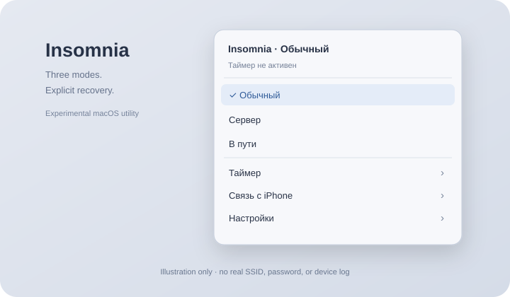

# Insomnia for macOS

**A native menu-bar prototype for temporary closed-lid sessions and optional iPhone hotspot recovery.**

[Русский](README.ru.md) · [Setup](docs/setup.md) · [Recovery](docs/recovery.md) · [Architecture](docs/architecture.md) · [Project story](docs/story.ru.md) · [MIT](LICENSE)



*Illustration, not a screenshot of a personal Mac or Wi-Fi network. The app UI is Russian. This project is unrelated to the Insomnia API client.*

## Before running

This is an **experimental source release**, not a broadly tested or independently audited privileged system utility. Active modes use an administrator-authorized Guardian process to run `pmset -a disablesleep 1`, a **global sleep setting**. Manual Sleep can also be affected. Restoration runs `pmset -a disablesleep 0`.

Read [recovery instructions](docs/recovery.md) and [the security review](docs/security-review.md) before enabling an active mode. Do not run multiple utilities that change `disablesleep`. Keep the computer ventilated; closed-lid operation is not guaranteed across hardware and macOS versions.

## Modes

| Mode | Power/session behavior | Network behavior |
| --- | --- | --- |
| Normal / «Обычный» | No Insomnia sleep prohibition is active | Does not start hotspot recovery |
| Server / «Сервер» | External power required; unplugging ends the session | Does not automatically enable iPhone networking |
| Travel / «В пути» | Battery or external power; battery cutoff and optional deadline | Prefers the configured iPhone hotspot unless a working wired route is present |

Server defaults to no time limit; Travel defaults to 60 minutes. Each mode keeps its own duration. The default Travel battery cutoff is 15%. Editing a running timer restarts its countdown.

A separate Guardian checks the GUI heartbeat, deadline, power, battery, and actual sleep-disable flag. It attempts restoration if the GUI exits or its lease becomes stale. A forcibly killed Guardian, reboot, power loss, or failed recovery can still require manual intervention.

On detected lid closure, Server requests display sleep immediately; Travel waits 120 seconds of continuous closure. Reopening or an unknown sensor resets that countdown. The display command can affect external displays too.

## Network behavior and permissions

Travel mode can retain a working wired route, including iPhone USB, or attempt to join your configured hotspot. It respects Wi-Fi being turned off. A currently connected hotspot with unconfirmed internet is not repeatedly disconnected. On a manual mode change, it attempts a return to visible, already saved Wi-Fi networks; that return is best effort.

The hotspot password is stored in macOS Keychain. macOS Location permission is requested to access Wi-Fi SSID information; the source does not request geographic coordinates. Read [privacy and network requests](docs/privacy.md) before use: active connectivity checks contact Apple and Cloudflare endpoints, not your AI accounts.

## Build and offline checks

The preview app targets **Apple Silicon / arm64, macOS 13+**. You need compatible Apple Command Line Tools with Swift and Python 3 for optional tooling/audit. No third-party Swift packages are required.

```sh
python3 scripts/audit-source.py
./scripts/check.sh
./scripts/build.sh
```

Output: `dist/Insomnia.app`. These commands **do not launch the app, request administrator authorization, change power settings, join Wi-Fi, read saved passwords, or install login items**. Tests use synthetic policy states, mock restore operations, and temporary files. Guardian is executed only with `--self-test`, which returns before any privileged code path.

Open the app yourself after reading setup/recovery. It starts in Normal mode. The public namespace is `local.insomnia`; it intentionally does not automatically migrate settings or Keychain entries from an older private build. Never run the private and public editions together during an active session.

## Publication package

```sh
./scripts/release.sh
python3 scripts/package-source.py
```

`dist/` contains an arm64 preview zip, its SHA-256 file, and a clean source zip. All are ignored by Git. Source and binary packaging excludes local logs, personal deployment instructions, old archives, Keychain exports, live SSIDs/passwords, session files, and Git history. No GitHub push or release is performed by the scripts.

The app is ad-hoc signed, not Developer ID signed or notarized. The root helper architecture needs further review before broad binary distribution. See [publishing](docs/publishing.md), [development](docs/development.md), and [release notes](RELEASE_NOTES.md).

## Documentation

- [Setup and permissions](docs/setup.md)
- [Sleep recovery and removal](docs/recovery.md)
- [Architecture and watchdog behavior](docs/architecture.md)
- [Privacy and stored data](docs/privacy.md)
- [Security findings and remaining boundaries](docs/security-review.md)
- [Development and offline test coverage](docs/development.md)
- [Troubleshooting](docs/troubleshooting.md)
- [Local validation](docs/validation.md)
- [Story of the project, Russian](docs/story.ru.md)

Licensed under [MIT](LICENSE). This is not an Apple product and is not associated with Kong’s Insomnia API client. Apple, iPhone, and macOS names identify the target platform and connection method.
