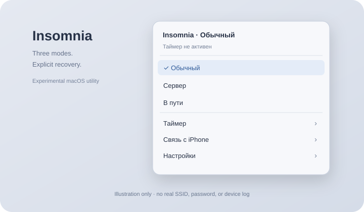

# Insomnia для macOS

**Нативная утилита строки меню: временная работа с закрытой крышкой и подключение к раздаче iPhone.**

[English](README.md) · [Рассказ](docs/story.ru.md) · [Восстановление сна](docs/recovery.md) · [Подготовка GitHub](docs/publishing.md) · [MIT](LICENSE)



*Это схема, не снимок личного компьютера. Проект не связан с одноимённым API-клиентом Insomnia.*

## Статус и важное ограничение

Версия 0.6.2 — экспериментальная публичная копия частной наработки 0.6.1. Активные режимы с разрешения администратора запускают Guardian, который включает **глобальный** запрет сна командой `pmset -a disablesleep 1`. Завершение снимает его через `pmset -a disablesleep 0`.

Перед запуском прочитай [инструкцию восстановления](docs/recovery.md) и [границы безопасности](docs/security-review.md). Ручной пункт «Сон» тоже может перестать работать. Не запускай одновременно несколько утилит, меняющих этот флаг. Используй хорошо проветриваемую поверхность. Совместимость работы с закрытой крышкой на всех Mac не подтверждена.

## Что делает приложение

- **Обычный:** Insomnia не запрещает сон, работают системные правила.
- **Сервер:** активный сеанс только от внешнего питания; отключение питания завершает режим. iPhone автоматически не подключается.
- **В пути:** сеанс от батареи или сети, с порогом заряда и приоритетом выбранной раздачи iPhone. Рабочее проводное соединение сохраняется.

Таймеры раздельные. По умолчанию сервер работает без срока, режим «В пути» — 60 минут. Изменение таймера активного режима начинает отсчёт заново. На батарее по умолчанию применяется порог 15%.

Guardian отдельно проверяет heartbeat интерфейса, таймер, питание, батарею и состояние системного флага. Это резервный контроль, а не гарантия восстановления после принудительного убийства самого Guardian, перезагрузки или сбоя системы.

При закрытии крышки сервер запрашивает сон дисплея сразу; режим «В пути» — через 120 секунд непрерывно закрытой крышки. Открытие отменяет отсчёт. Команда может затронуть внешние дисплеи.

При работе с iPhone приложение проверяет интернет через HTTPS-адреса Apple и Cloudflare. Пароль раздачи хранится в Связке ключей. Для чтения SSID macOS требует разрешение геолокации; координаты приложение не запрашивает. [Полное описание данных](docs/privacy.md).

## Сборка

Готовая сборка рассчитана на Apple Silicon и macOS 13+. Нужны Apple Command Line Tools со Swift; Python 3 используется для аудита и вспомогательных скриптов.

```sh
python3 scripts/audit-source.py
./scripts/check.sh
./scripts/build.sh
```

Результат — `dist/Insomnia.app`. Сборка и автономные тесты не запускают приложение, не запрашивают права администратора, не меняют сон и сети и не читают пароли. Проверки восстановления используют подставленные функции, а Guardian вызывается только с `--self-test`.

Приложение запускай сам после изучения [настройки](docs/setup.md) и [восстановления](docs/recovery.md). Стартовый режим — обычный. Публичная версия использует нейтральный идентификатор `local.insomnia`, отдельные настройки и запись пароля; автоматического переноса из прежней частной сборки нет. Две версии одновременно в активном режиме запускать нельзя.

## Публикация

Подготовлены MIT, документация, история разработки, CI, шаблоны issue/PR, `.gitignore`, аудит исходников и скрипты упаковки. В публичной папке нет старых журналов, личных инструкций переноса, исходной истории Git или данных аккаунтов.

```sh
./scripts/release.sh
python3 scripts/package-source.py
```

Архивы и SHA-256 появятся в `dist/`. Сборка подписана только локальной ad-hoc подписью; Developer ID и нотарификации пока нет. [Инструкция публикации](docs/publishing.md) отделяет открытие исходников от широкого распространения привилегированного бинарного приложения.
