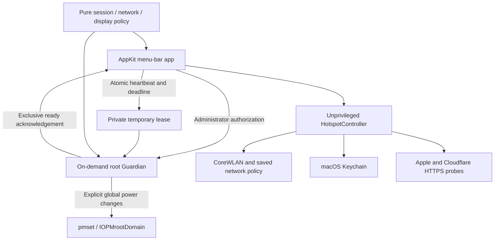

# Architecture

## Source modules

| File | Responsibility |
| --- | --- |
| `App.swift` | Menu, mode transitions, prompts, timers, heartbeat, helper lifecycle, optional login launch |
| `Guardian.swift` | Root-only session loop and explicit restore action; unprivileged `--self-test` path |
| `Shared.swift` | Session lease, battery state, policy, command timeout, restore attempts, display countdown |
| `ReadyAcknowledgement.swift` | Exclusive descriptor-relative creation of the acknowledgement file |
| `Hotspot.swift` | Keychain, route monitoring, connectivity probes, hotspot join and saved-network return |
| `NetworkPolicy.swift` | Pure decisions, reconnect backoff, and ordering of known networks |

## Session lifecycle

The GUI starts in Normal mode. Server/Travel first validate power, battery, and existing sleep-disable state. A new private mode-0700 temporary directory receives an atomic JSON lease. The app marks a potentially unfinished session in its preferences and launches the bundled helper through an administrator-authorized AppleScript call.

Guardian refuses an already active or unreadable global prohibition before activation. It enables `disablesleep`, checks the actual kernel flag, creates a per-session acknowledgement, and polls stop conditions. The GUI begins the user timer after acknowledgement and updates the lease about every two seconds.

The lease stores a heartbeat timestamp and optional deadline; zero means no deadline. Malformed, missing, stale, or implausibly future timestamps end the session. Server additionally requires AC power. Travel applies its battery threshold only while on battery.

Mode changes terminate the old session before starting a new one. A successful GUI transition is not inferred from the global flag alone because another process can also modify it.

## Recovery

Guardian attempts `pmset -a disablesleep 0` with bounded retries and verifies the flag. The UI reads the resulting status and either returns to Normal or offers explicit recovery. This is a shared system flag, not an exclusive per-app assertion. No inter-process protocol coordinates Insomnia with unrelated utilities, so concurrent writers remain a limitation.

The session uses wall-clock lease timestamps and monotonic timing for local display/sleep-state policies. Clock changes may trigger fail-closed session termination.

## Display policy

Guardian reads `AppleClamshellState`. Server requests display sleep on closure; Travel waits 120 seconds. Opening, unknown sensor state, mode exit, or a new Guardian discards the countdown. The request is `pmset displaysleepnow`, not a brightness setting and not a change to persistent display timeout preferences.

The implementation reads IOKit root-domain properties whose behavior can vary with hardware/OS. Do not equate policy tests with a physical closed-lid verification.

## Network policy

An unprivileged controller monitors routes and checks connectivity while Travel or an explicit network-return operation is active. A working wired route wins. Otherwise Travel prefers the configured iPhone, respects disabled Wi-Fi, and waits rather than repeatedly reassociating an already connected hotspot during an outage. Retry backoff grows to 60 seconds, plus scan/probe duration.

Return candidates are visible networks already saved in macOS, with the previous network first when still saved. Unknown networks and the hotspot itself are excluded. Saved Wi-Fi passwords are requested through macOS Keychain APIs and used in memory. The controller does not change system network-service order or guarantee the selected route on behalf of macOS.

## Publication edition

The public namespace is `local.insomnia`, separate from older private builds. The 0.6.2 source edition removes automatic menu-bar diagnostics and does not include historical display/network recordings or private handoff/deployment notes. The UI, Keychain, and privilege flow require manual hardware tests beyond the offline suite.

See [interface references](references.md) for vendor documentation and implementation sources.
